<p align="center">
  
</p>

<p align="center">
  <a href="https://www.linkedin.com/in/jonathansinien/"></a>
  <a href="https://huggingface.co/4math"></a>
  <a href="https://x.com/Vesuviian"></a>
  <a href="https://www.youtube.com/@professorchain"></a>
</p>

<h3 align="center">I design AI systems that agents can rely on:<br>MCP servers, open models on GPUs you control, and the cloud underneath.</h3>

<p align="center"><sub>Paris, France · AI architecture · Model Context Protocol · NVIDIA · Hugging Face · AWS · DevSecOps</sub></p>

---

## 🧭 What I do

<table>
<tr>
<td width="50%" valign="top">

### 🔌 MCP servers and agent tools
I turn an API, a product or a workflow into tools any AI agent can call: typed inputs, guard rails that explain how to fix a bad call, stdio and HTTP transports, tests and docs.

</td>
<td width="50%" valign="top">

### 🟩 Open models on your GPUs
Open models such as Nemotron, Mistral and gpt-oss, served with vLLM or managed inference, from serverless GPUs to on-prem clusters linked by InfiniBand, and wired into the agents and editors your team already uses.

</td>
</tr>
<tr>
<td width="50%" valign="top">

### 🇪🇺 Sovereign AI
Architectures that keep your data where you decide: European cloud, on-prem AI factories, RAG over your own documents, with a cost model for each option.

</td>
<td width="50%" valign="top">

### ☁️ Cloud and DevSecOps foundations
AWS multi-account platforms, Terraform, Kubernetes, CI/CD, Security Hub and FinOps: the ground an AI system needs to run safely and at a known cost.

</td>
</tr>
</table>

## 🚀 Flagship: Tiled Map Builder MCP

<a href="https://github.com/4math2379/Tiled-MCP-Server"></a>

**An MCP server that lets AI agents build isometric [Tiled](https://www.mapeditor.org) maps**: rooms, corridors, doors, traps, chests and spawns, validated and saved as files that open directly in Tiled.

- 🗺️ **30 MCP tools**, 3 one-call layout presets and 20 themes, 12 of them with bundled isometric sprites.
- 🛡️ **Built for agents**: an invalid placement fails with a message that says how to fix it, and `validate_map` checks the map before export.
- 🔌 Works with **any MCP client**: Claude Code, Claude Desktop, Cursor, VS Code, Zed, OpenCode, and agents running NVIDIA Nemotron.
- 🤗 **Live on Hugging Face**: describe a map in any language and download it, or connect your agent to the hosted MCP endpoint. Paid model calls run on the visitor's own Hugging Face account.

<p>
  <a href="https://huggingface.co/spaces/4math/tiled-map-builder"></a>
  <a href="https://github.com/4math2379/Tiled-MCP-Server"></a>
</p>

```bash
claude mcp add --transport http tiled-map-builder https://4math-tiled-map-builder.hf.space/mcp \
  --header "Authorization: Bearer hf_YOUR_TOKEN"
```

## 🧪 More open work

| Project | What it is | Built with |
|---|---|---|
| **[nvidia-coding-agent-lab](https://github.com/4math2379/nvidia-coding-agent-lab)**<br><sub>[▶ animated architecture](https://4math2379.github.io/nvidia-coding-agent-lab/)</sub> | An NVIDIA-specialised coding agent: Nemotron served with vLLM on serverless GPUs, wired into Zed and OpenCode, with NVIDIA's docs available over MCP. The same container runs on-prem, and a multi-node InfiniBand lab rehearses the cluster. | Nemotron · vLLM · Modal · MCP |
| **[Recherches-IA-Souveraine](https://github.com/4math2379/Recherches-IA-Souveraine)** 🇫🇷 | Research reports and Terraform templates for hosting generative AI while keeping control of your data: Mistral on Scaleway, NVIDIA InfiniBand AI factories, GPU clusters with Slurm. | Mistral · Scaleway · NVIDIA · Terraform |
| **[FAB_Prediction_Model](https://huggingface.co/4math/FAB_Prediction_Model)** 🤗 | An open model (MIT) that predicts the win rate of custom decks for the Flesh and Blood card game, trained on simulated games. An educational project on machine learning for game balance. | scikit-learn · Hugging Face |
| **[aws-security-hub-soc](https://github.com/4math2379/aws-security-hub-soc)** | Security assessment across AWS accounts for SOC and audit teams: Security Hub findings plus Prowler audits. | AWS · Prowler · Shell |
| **[aws-finops-tools](https://github.com/4math2379/aws-finops-tools)** | A Docker-based toolkit for AWS cost management and optimisation. | AWS · Docker |

## 🔭 Now

I'm moving my agent work into the open. The MCP servers and models behind my projects are being published here and on [Hugging Face](https://huggingface.co/4math), one at a time, each with docs, tests and a live demo.
**⭐ Star or follow to get them first.**

## 🧱 Toolbox

| | |
|---|---|
| **AI and agents** |        |
| **Languages** |    |
| **Cloud and platform** |      |
| **Delivery and security** |    |

## 📈 Track record

<table>
<tr>
<td align="center" width="25%"><h3>100+</h3><sub>AWS resources automated<br>across multiple accounts</sub></td>
<td align="center" width="25%"><h3>20+</h3><sub>applications shipped<br>through CI/CD pipelines I built</sub></td>
<td align="center" width="25%"><h3>−40%</h3><sub>cloud infrastructure costs<br>after optimisation</sub></td>
<td align="center" width="25%"><h3>10+</h3><sub>AWS accounts covered<br>by Security Hub</sub></td>
</tr>
</table>

<sub>Most of my professional work lives in private repositories; what you see here is the open part.</sub>

## 🤝 Let's work together

Building an AI agent, an MCP server for your product, or a private AI platform? I can help with **architecture reviews**, **MCP server design and builds**, and **open-model deployments** on cloud or on-prem GPUs.

<a href="https://www.linkedin.com/in/jonathansinien/"></a>

---

<p align="center">
  <i>"Between AI, DevOps and game design, I share my creations and take you behind the scenes of how they're made."</i>
</p>

<p align="center">
  
</p>
